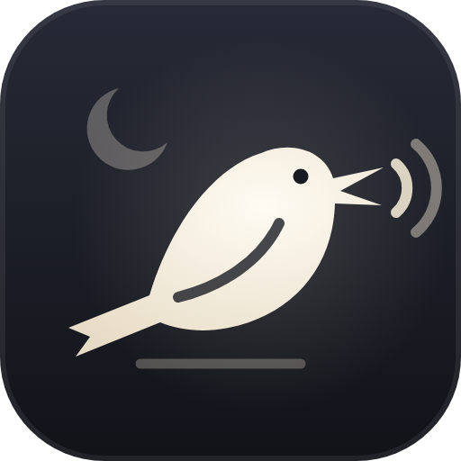
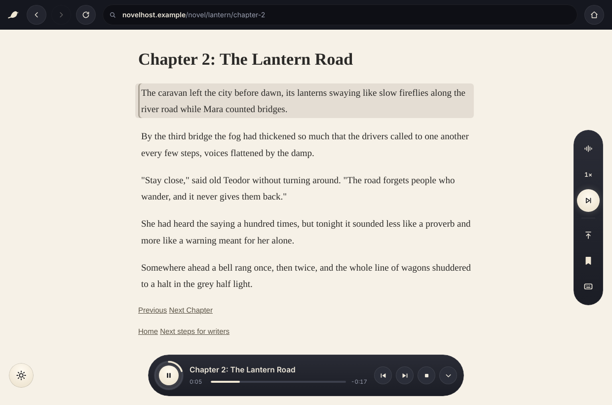
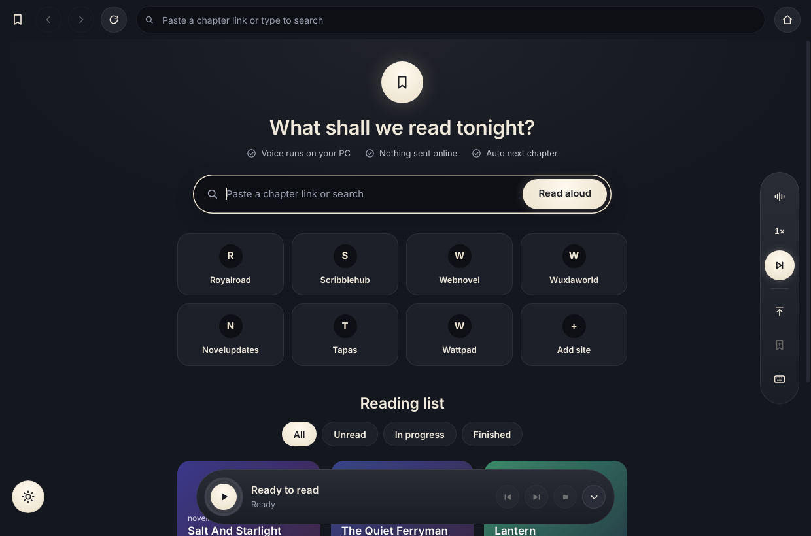
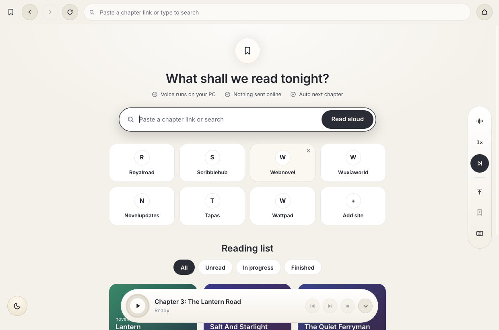
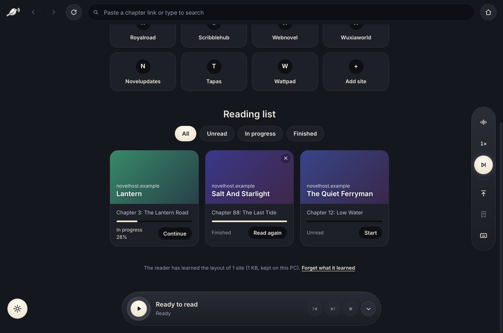
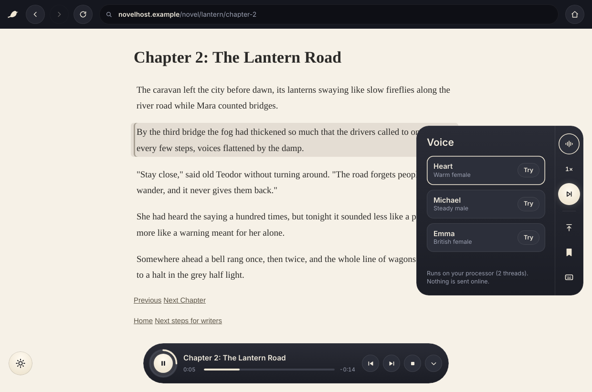
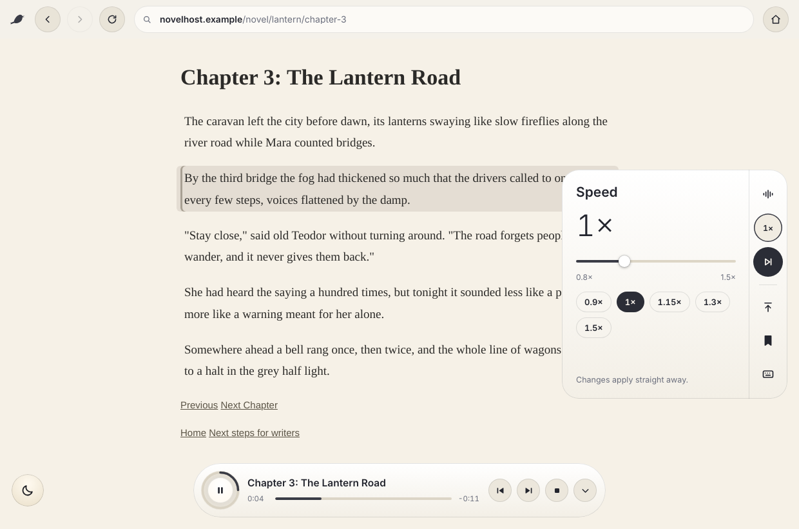
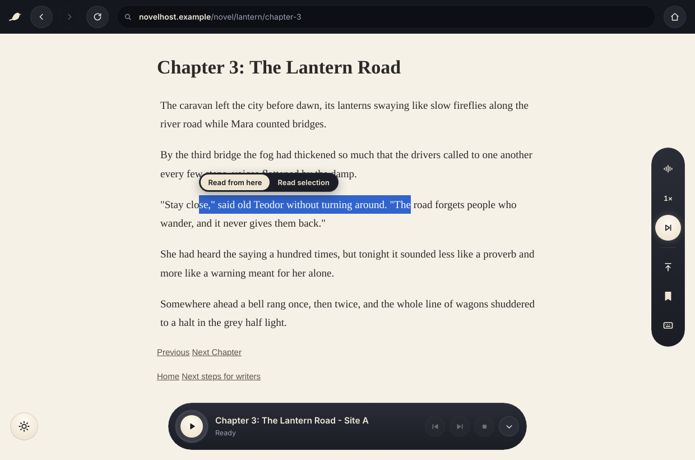
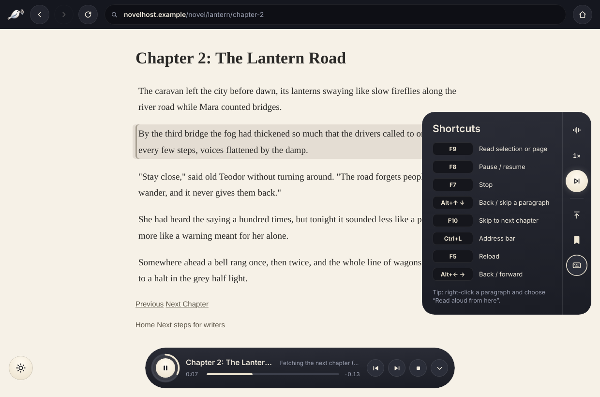

<p align="center"></p>

<h1 align="center">Nightingale Reader</h1>

<p align="center"><b>A light Windows browser that reads web novels aloud, with a natural voice that runs on your own PC.</b></p>

Paste a chapter link and press play. It reads the chapter, highlights each paragraph as it goes, then opens the next chapter by itself and keeps reading.



## Contents

- [Install](#install)
- [Using it](#using-it)
- [Features](#features)
- [Screenshots](#screenshots)
- [The voice model](#the-voice-model)
- [Keyboard shortcuts](#keyboard-shortcuts)
- [Privacy](#privacy)
- [Troubleshooting](#troubleshooting)
- [Run from source](#run-from-source)
- [Credits](#credits)

## Install

Needs Windows 10 or 11 (64-bit), about 400 MB of disk space and an internet connection the first time.

1. Download **Nightingale-Reader-0_5-win-x64.zip** from the [Releases](../../releases) page.
2. Unzip the whole folder anywhere, for example your Desktop. Keep all the files together.
3. Double-click **Nightingale Reader.exe**.
4. If Windows shows **"Windows protected your PC"**, click **More info**, then **Run anyway**. This appears because the app isn't code-signed yet.
5. On first start it downloads the voice (about 90 MB). The round button at the bottom shows the progress. If the download is interrupted, it carries on where it stopped next time.

To update, unzip the new version and run it. Your voice, settings and reading list are kept, because they live in your user folder (`%APPDATA%\Nightingale Reader`), not in the app folder. Coming from an older build called Reader Browser? Its data is moved over automatically on first start.

To uninstall, delete the app folder, and `%APPDATA%\Nightingale Reader` if you also want to remove the voice and your data.

## Using it

1. Paste a chapter link on the start page and press **Read aloud**, or open a page and press the round play button at the bottom (F9).
2. The paragraph being read is highlighted, and the page scrolls along.
3. When the chapter ends, it opens the next one and keeps going. Turn this off with the lit button in the middle of the right-hand rail.
4. To start somewhere else, select text and choose **Read from here**. You can also right-click a paragraph, or drag the seek bar.

## Features

### Reading
- **Hands-free chapters.** Finds the chapter text on most novel and article sites, reads it, clicks Next and carries on.
- **Never stuck on Next.** If a site has no Next button, it follows the chapter numbers in the address (`…/chapter-41` → `…/chapter-42`). At the real end of a novel it tells you you're caught up.
- **No gaps.** About 25 seconds of speech is prepared ahead, and the next chapter loads while the current one is still finishing.
- **Picks up where you stopped** in every chapter. **Read from the top** is on the rail.

### Player
- **Seek bar** with elapsed and remaining time. Click or drag to jump anywhere in the chapter.
- **Paragraph back and skip**, safe to press as fast as you like. Back replays the paragraph you're in, and pressing it again goes to the one before.
- **Read from here** (from any selected sentence) or **Read selection** (just the selected text).
- **Three voices**, each with a "Try" sample, and **speed** from 0.8× to 1.5×. Changes apply straight away.
- **Fold the player** down to just the play button.

### Learns as you read, on your PC
A tiny local learner (a few KB per site) remembers:
- each site's Next button,
- where the chapter text sits on the page,
- whether chapter links count up,
- repeated lines to skip, such as "Translator: …" or "Read this at …".

It only learns from results it could check: a jump that really loaded a new chapter, or one that clearly failed. It drops what stops working, forgets sites you haven't visited in four months, and is capped at 400 KB. You can wipe it from the start page with **Forget what it learned**.

### Library
- **Reading list.** Save a novel with the bookmark on the rail. It keeps track of the chapter you're on and your progress, sorted into Unread, In progress and Finished.
- **Favourite sites** on the start page.

### Light on your PC
- The voice runs on the **graphics card** (DirectML) when that's faster. Otherwise it uses as few processor threads as it can at low priority. The Voice panel shows which one it chose.
- The voice **sleeps after 4 idle minutes**, freeing its memory, and wakes when you press play.
- The app's own panels **share one process**, and ad frames don't get their own processes.
- **Built-in ad blocking** and a **capped browser cache**.

### Looks
- **Dark and light themes.** Switch with the round button at the bottom left.

## Screenshots

| | |
| --- | --- |
|  |  |
| **Start page.** Paste a link and press Read aloud, or pick a favourite site. | **Light theme.** |
|  |  |
| **Reading list** with progress for each novel. | **Voice panel.** Pick a voice, press Try to hear it, and see where the voice runs. |
|  |  |
| **Speed** from 0.8× to 1.5×. | **Read from here** on any selected sentence. |
|  |  |
| **Shortcuts** at a glance. | **Seek bar** and paragraph controls. |

## The voice model

| | |
| --- | --- |
| Model | [Kokoro-82M v1.0](https://huggingface.co/hexgrad/Kokoro-82M) by hexgrad, 82 million parameters, based on StyleTTS 2 |
| File used | [onnx-community/Kokoro-82M-v1.0-ONNX](https://huggingface.co/onnx-community/Kokoro-82M-v1.0-ONNX), `onnx/model_quantized.onnx` (8-bit, about 90 MB) |
| Audio | 24 kHz, English |
| Voices | Heart (warm female, US), Michael (steady male, US), Emma (British female) |
| Runs with | [kokoro-js](https://github.com/hexgrad/kokoro) 1.2.1 and [Transformers.js](https://github.com/huggingface/transformers.js) 3.8.1 on [ONNX Runtime](https://onnxruntime.ai) 1.21: DirectML on the graphics card, or the processor |
| Licence | Apache 2.0 |

The 8-bit model is the smallest version of Kokoro and gives the best balance of speed and quality. It's downloaded once from Hugging Face into `%APPDATA%\Nightingale Reader\models`. Each file is checked before use, and a damaged file is downloaded again automatically.

On first start the app times a short test sentence. It uses the graphics card if that's fast enough, and otherwise adds processor threads one at a time until the voice comfortably keeps ahead of playback.

## Keyboard shortcuts

| Key | Action |
| --- | --- |
| F9 | Read selection or page |
| F8 | Pause / resume |
| F7 | Stop |
| F10 | Skip to next chapter |
| Alt+↑ / Alt+↓ | Back / skip a paragraph |
| ← / → on the seek bar | Back / forward 10 seconds |
| Ctrl+L | Address bar |
| F5 | Reload |
| Alt+← / Alt+→ | Back / forward |

## Privacy

Everything stays on your computer: the voice, what it learns about sites, your reading list and your reading positions. The only network traffic is the web pages you open and the one-time voice download from Hugging Face. There are no accounts, no analytics and no telemetry.

## Troubleshooting

| Problem | Fix |
| --- | --- |
| "Windows protected your PC" | Click **More info**, then **Run anyway**. |
| The voice didn't load | Check your connection and press **Retry** on the player. Broken or half-finished downloads are repaired automatically. |
| It doesn't find the text on a site | Select the first sentence and choose **Read from here**. |
| It doesn't go to the next chapter | Press **F10**, or click the site's Next link yourself. It learns that site's button for next time. |
| The voice is slow on an older PC | Open the Voice panel to see where the voice runs. Closing heavy apps helps, since the voice runs at low priority. |

## Run from source

Needs [Node.js](https://nodejs.org) 20 or newer, on Windows.

```
git clone https://github.com/Bray-Consultants/nightingale-reader.git
cd nightingale-reader
npm install
npm start
```

| File | What it does |
| --- | --- |
| `main.js` | Window, page view, floating panels, next-chapter logic, ad blocking |
| `renderer.js` | Reading engine: sentences, buffering, playback, skipping and seeking |
| `tts-worker.mjs` | Voice process: safe resumable download, graphics card or processor, speech generation |
| `brain.js` | The local learner (per-site memory and Next-button scorer) |
| `library.js` | Reading list, favourite sites, preferences |
| `page-scripts.js` | Small functions run inside web pages (find text, highlight, find Next) |
| `index.html` | Top bar |
| `overlay-*.html/js` | Floating player, tool rail, theme button |
| `start.html/js` | Start page |
| `preload-*.js` | Safe bridges between pages and the app |
| `assets/` | Logo (SVG and PNG) and the Windows icon |
| `tools/stamp-exe.js` | Puts the icon and name into the Windows .exe for a release build |

## Credits

- Voice: [Kokoro-82M](https://huggingface.co/hexgrad/Kokoro-82M) by hexgrad (Apache 2.0)
- [kokoro-js](https://github.com/hexgrad/kokoro), [Transformers.js](https://github.com/huggingface/transformers.js) and [phonemizer.js](https://github.com/xenova/phonemizer.js) (Apache 2.0)
- [ONNX Runtime](https://onnxruntime.ai) (MIT)
- [Electron](https://www.electronjs.org) (MIT)

Logo and app by Bray Consultants.
